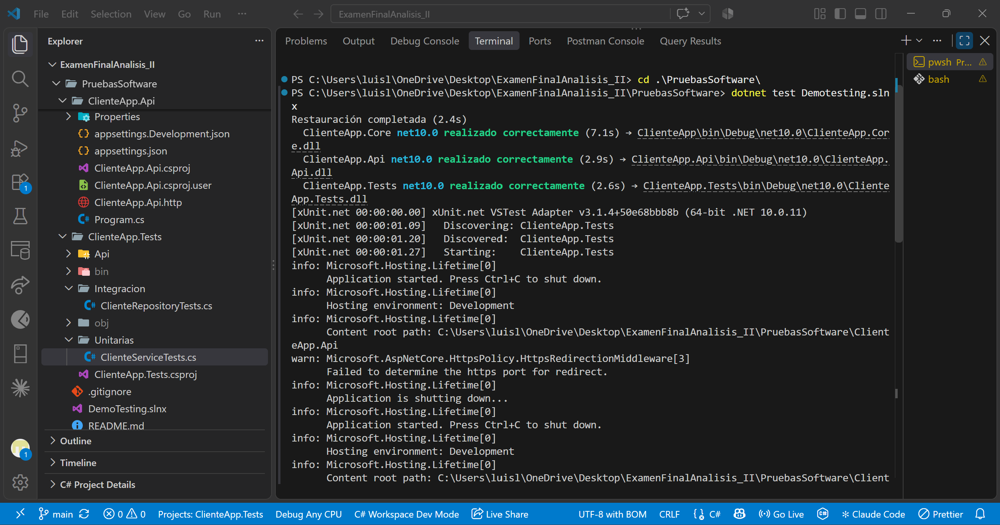
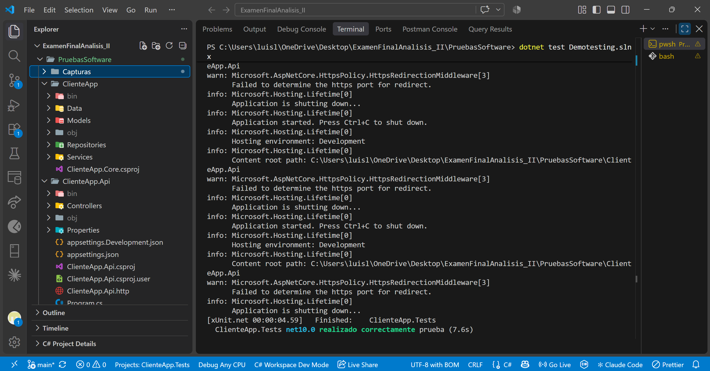
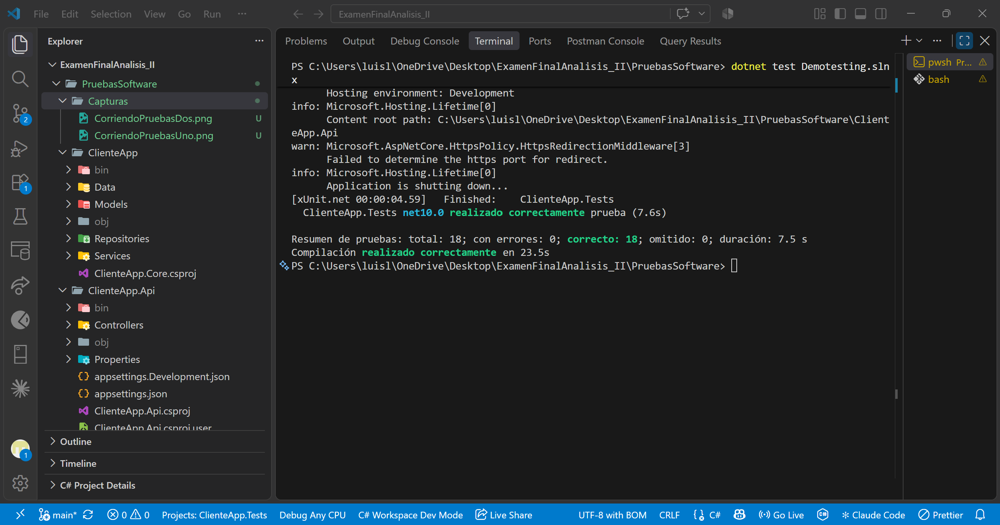

# Luis Carlos Lima Pérez 0907-23-20758

# Examen Final Analisis de Sistemas II - Pruebas de Software

Ejemplos de pruebas de software: unitarias, integración y API.

## Resumen

El proyecto contiene un total de **18 pruebas automatizadas** que verifican el
funcionamiento de la aplicación de clientes:

- **Pruebas unitarias:** comprueban por separado las reglas del servicio, como
  validar un correo, registrar un cliente o buscar un cliente por su
  identificador.
- **Pruebas de integración:** comprueban que el servicio y el repositorio
  funcionan juntos con una base de datos SQLite real, incluyendo el caso de un
  cliente que no existe.
- **Pruebas de API:** comprueban las respuestas del servicio web al registrar
  clientes y al consultarlos, confirmando los códigos 200 OK, 404 Not Found,
  201 Created y 400 Bad Request según corresponda.

Todas las pruebas se ejecutan con:

```cmd
dotnet test DemoTesting.slnx
```

## Capturas de la ejecución






